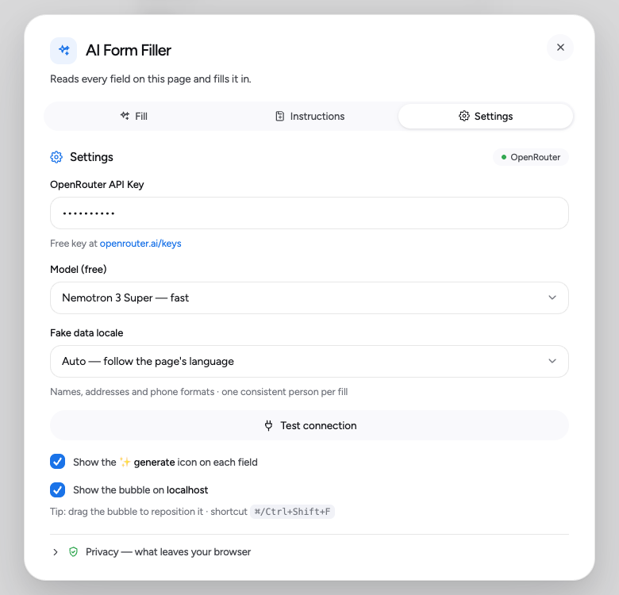
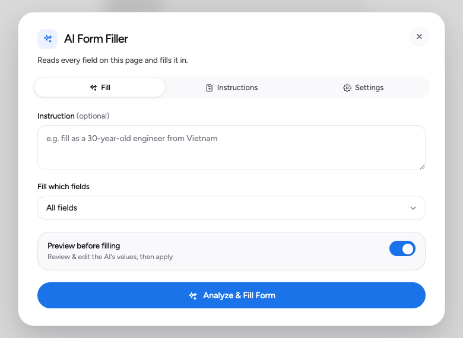
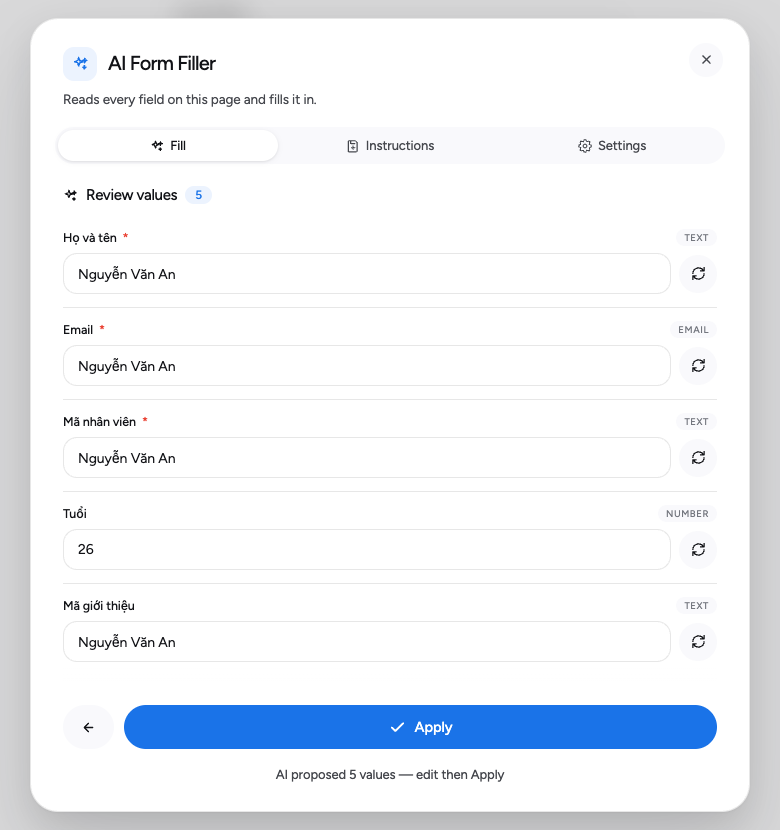

# 🤖 AI Form Filler

A Chrome extension (Manifest V3) that analyzes **every form field on the current page** and fills them with realistic, coherent data using **free AI models on OpenRouter** — bring your own free API key, nothing to install on the backend.

It works on plain HTML inputs **and** modern component libraries: shadcn / Radix Selects, react-day-picker date pickers, comboboxes with async-loaded options, checkboxes, radios, and textareas.

 

**👉 [Hướng dẫn cài đặt](#-cài-đặt-cho-chrome--edge) · [⬇️ Tải bản mới nhất](https://github.com/haonguyenstech/ai-form-filler/releases/latest)**

---

## 🚀 Cài đặt cho Chrome / Edge

**[⬇️ Tải bản mới nhất (file .zip)](https://github.com/haonguyenstech/ai-form-filler/releases/latest)** — tải file `.zip`, rồi làm theo 6 bước bên dưới. Mất khoảng 2 phút.

Tiện ích chạy trên **Google Chrome** và **Microsoft Edge** trên máy tính.

### Bước 1 — Tải file .zip về máy

Mở trang [Releases](https://github.com/haonguyenstech/ai-form-filler/releases/latest), ở mục **Assets** bấm vào file
`ai-form-filler-x.y.z.zip`. Trình duyệt tải về một file .zip nhỏ (khoảng 100 KB) vào thư mục **Downloads (Tải xuống)**.

> Đừng bấm *Source code (zip)* — đó là mã nguồn kèm bộ test, không phải bản cài.

### Bước 2 — Giải nén ra một thư mục và để yên ở đó

- **Trên Mac:** bấm đúp vào file .zip, máy sẽ tạo một thư mục cùng tên.
- **Trên Windows:** bấm chuột phải vào file .zip, chọn **Extract All (Giải nén tất cả)** rồi bấm **Extract**.

Nên chuyển thư mục vừa giải nén vào **Documents (Tài liệu)** để khỏi lỡ tay xoá.

> 📌 Trình duyệt chạy tiện ích trực tiếp từ thư mục này. Xoá hoặc di chuyển thư mục thì tiện ích sẽ ngừng hoạt động.

### Bước 3 — Mở trang Tiện ích của trình duyệt

Chép địa chỉ bên dưới, bấm vào thanh địa chỉ của trình duyệt, dán (**Ctrl + V**, trên Mac là **Command + V**) rồi bấm **Enter**.

| Chrome | Edge |
|---|---|
| `chrome://extensions` | `edge://extensions` |

> 📌 Trang web không được phép mở sẵn địa chỉ này cho bạn, nên phải dán vào thanh địa chỉ.

### Bước 4 — Bật Developer mode (Chế độ nhà phát triển)

- **Chrome:** ở góc **trên bên phải** của trang, bật công tắc **Developer mode**.
- **Edge:** ở **cột bên trái** của trang, gần phía dưới, bật công tắc **Developer mode**.

> 📌 Chế độ này chỉ cho phép cài tiện ích từ một thư mục trên máy, không làm thay đổi gì khác.

### Bước 5 — Bấm Load unpacked và chọn thư mục đã giải nén

Sau khi bật Developer mode, phía trên trang hiện thêm vài nút. Bấm **Load unpacked (Tải tiện ích đã giải nén)**,
chọn thư mục đã giải nén ở bước 2 rồi bấm **Select (Chọn)**.

> 📌 Chọn đúng thư mục chứa file `manifest.json`, không chọn file .zip.

### Bước 6 — Ghim tiện ích và nhập API key

1. Bấm biểu tượng **mảnh ghép** 🧩 trên thanh công cụ của trình duyệt, bấm **ghim** 📌 cạnh *AI Form Filler* để nó luôn hiện ra.
2. Lấy API key miễn phí: đăng nhập [openrouter.ai](https://openrouter.ai), vào [openrouter.ai/keys](https://openrouter.ai/keys), bấm **Create Key** và chép key (bắt đầu bằng `sk-or-v1-`).
3. Mở một trang bất kỳ có form, bấm vào **bong bóng xanh** ở góc dưới bên phải (hoặc biểu tượng tiện ích), chọn tab **Settings**, dán key vào ô **OpenRouter API Key** rồi bấm **Test connection**. Hiện *Connected* là xong.

> 📌 Key miễn phí cho 50 lượt/ngày với các model `:free` (nạp 10 credits thì lên 1000 lượt/ngày). Hết lượt
> tiện ích vẫn điền được form bằng dữ liệu tạo sẵn trong máy.

<p align="center"></p>

### Xong — cách dùng

Mở trang có form → bấm bong bóng → **Analyze &amp; Fill Form**. Bật **Preview before filling** để xem và sửa từng giá trị trước khi điền.
Phím tắt: `⌘ Shift F` (Mac) / `Ctrl Shift F` (Windows).

<p align="center"> </p>

### Cập nhật lên bản mới

1. **Tải bản mới và giải nén** — tải file .zip mới ở trang [Releases](https://github.com/haonguyenstech/ai-form-filler/releases/latest) và giải nén.
2. **Chép đè vào thư mục cũ** — chép toàn bộ nội dung thư mục mới đè lên thư mục đang cài (thư mục bạn đã chọn khi Load unpacked), đồng ý thay thế các file trùng tên.
3. **Tải lại tiện ích** — mở lại `chrome://extensions` (hoặc `edge://extensions`), tìm *AI Form Filler* và bấm biểu tượng **mũi tên vòng tròn (Reload)** trên thẻ của nó. Các tab đang mở cần tải lại trang (F5) để nhận bản mới.

> ⚠️ Đừng bấm **Remove (Xoá)** tiện ích rồi cài lại: xoá tiện ích sẽ xoá luôn API key, instruction đã lưu và cài đặt của bạn.

### Cho developer — chạy từ mã nguồn

```bash
git clone https://github.com/haonguyenstech/ai-form-filler.git
```

Rồi làm từ bước 3, ở bước 5 chọn thư mục vừa clone. `./build.sh` đóng gói ra `dist/ai-form-filler-<version>.zip` (file được đính kèm ở Releases).

## ✨ Features

- **One-click fill** — a floating bubble scans the page, asks the AI, and fills everything, then dismisses itself so you can see the result. An optional **Preview** step lets you review and edit each value before applying.
- **Per-field ✨ icon** — a Grammarly-style button appears on the focused field; click it to generate just that one value.
- **Saved instructions** — store reusable prompts (e.g. *"fill as a 30-year-old engineer from Vietnam"*) and mark one as the ⭐ default that pre-fills on new pages.
- **Respects the page's validation** — `pattern`, `min`/`max`/`step` and `minLength` go to the model. After the fill the extension asks the page which values it rejected (native constraint validation, plus the `aria-invalid` + error text that form libraries show). Those fields go back to the model with the page's own error message, and a field that still fails its `pattern` gets a value built from the pattern itself. Undo still restores the original values.
- **One consistent person per fill, in the right locale** — every fill invents one persona (name, email, phone, address, company, birth date). The model is told to use it, so the email matches the name and the phone/postcode formats match the country. *Settings → Fake data locale* picks English, Vietnamese, Japanese, French, German or Spanish. *Auto* follows the page's `<html lang>`.
- **Never stuck on a quota** — if the AI can't answer (the free model's daily cap, a busy model, no network, a garbled reply), the form is still filled from locally generated data for the same persona, and the status says why. Only a missing or invalid key, or a wrong model id, still stops the fill.
- **Robust label detection** — never shows "field 3"; climbs the DOM for the real `<label>` / `aria-label` / placeholder.
- **Undo** the last fill, **per-site toggle**, **draggable bubble**, keyboard shortcut `⌘/Ctrl+Shift+F`.
- **Tabbed UI** — *Fill · Instructions · Settings*.

## 🔌 Model (Settings tab)

The extension calls **OpenRouter** (`openrouter.ai/api/v1/chat/completions`) straight from the
background service worker with your own API key — get a free one at
[openrouter.ai/keys](https://openrouter.ai/keys) and paste it into **Settings**. The **Model**
dropdown offers OpenRouter's free models; a fresh install starts on the first one:

| Model | Notes |
|---|---|
| `nvidia/nemotron-3-super-120b-a12b:free` | **default** — ~2–3s for a short reply |
| `cohere/north-mini-code:free` | fast |
| `poolside/laguna-s-2.1:free` | slower (~9s) |
| `nvidia/nemotron-3.5-lightning:free` | ~11–14s |
| `nvidia/nemotron-3-ultra-550b-a55b:free` | slowest (~30s through a full fill) |

**Custom…** takes any OpenRouter model id, paid ones included. OpenRouter's free catalogue
changes often; if a model errors, pick another or check `https://openrouter.ai/api/v1/models`.
Use **Test connection** in Settings to check the key and model; the button shows a spinner while
in flight and settles to *Connected* / *Failed*.

> Earlier versions defaulted to a keyless OpenCode Zen provider. OpenCode has since restricted
> its free tier to its own app, so that provider was removed in 0.3.5.

## 🎨 Design

The UI follows the [antigravity.google](https://antigravity.google/) design language: near-black
ink (`#121317`) for type, a cool blue-grey tint for every secondary surface, pill geometry and
hairline borders. Google blue (`#1A73E8`) carries the primary action — bubble, fill button,
per-field ✨ icon — so the dialog reads light rather than resting on a black slab; the other
brand colours appear only in the success confetti. Dark mode inverts the same token set and
flips the accent to `#8AB4F8`.

The type is **Google Sans Flex** where the system has it, falling back to **Figtree** (SIL OFL),
which ships in `fonts/` as two ~15 KB woff2 subsets — no network request, no page-CSP problem.
`@font-face` can't live inside a shadow root, so the family is registered on the document under
the private name `AIFF Sans` and referenced from the shadow CSS.

## 🖼 Icon

`icons/*.png` are generated, not hand-drawn — edit the SVG in `test/make-icons.mjs` and run:

```bash
cd test && npm run icons
```

The mark is a four-point sparkle on the same accent blue the UI uses. The 16/32 px files
are drawn from a **different** source shape than 48/128 (optical sizing): pointy arms and
the companion sparkle read as craft at 128 px and as dirt at 16 px, so the toolbar sizes
get a single, blunter, larger star.

## 🧠 How it works

- `inject.js` — content script (top frame, `<all_urls>`). Renders the bubble + a Shadow-DOM dialog so the page's CSS can't leak in or out. Holds all UI, settings, the per-field icon, and the review flow.
- `background.js` — service worker. Calls the AI (avoids page CORS) and orchestrates **extract → AI → fill → celebrate**. The extract/fill steps run in the page's **MAIN world** via `chrome.scripting.executeScript`, because synthetic clicks from the isolated content-script world don't reliably drive Radix widgets — the same clicks from the MAIN world do.
- `page-funcs.js` — self-contained functions injected into the page's MAIN world to scan fields, fill values (React-safe: native value setter + `input`/`change`/`blur` events), and run the success animation.

## 🎯 Coverage

`test/survey.mjs` loads the real extension, drives its UI with real pointer input, and answers
the AI call with values built from the request's own field list — no model in the loop, so the
numbers measure this code rather than the AI. Current run: **26 of 26 pages pass.**

| Group | Pages | Result |
|---|---|---|
| Forms inside a page dialog | native `<dialog>`, Bootstrap modal, Radix + Select, MUI Dialog, Headless UI, Ant Design Modal (local, `test/dialogs/`); mui.com form dialog, shadcn dialog, Bootstrap docs modal, Mantine modal (live) | 10/10 — every field filled, dialog stays open, nothing behind it touched |
| Plain pages | selenium web-form, demoqa, httpbin, formy, testautomationpractice, expandtesting, Bootstrap, MUI text field / select, Ant Design form, Element Plus, Vuetify, Mantine, Angular Material, Chakra, shadcn react-hook-form | 16/16 |

```bash
cd test && python3 -m http.server 5199 &   # the local dialog pages
node survey.mjs            # all 26     · node survey.mjs dialog   · node survey.mjs local
ORKEY=sk-or-... node survey.mjs local     # same pages against the real model
```

**Forms in dialogs.** With a page modal open, only its fields are scanned. The extension never
sends Escape to the document or clicks a modal's backdrop — popups it opened are closed through
their own backdrop or a press on a neutral spot inside the dialog, because React bubbles Escape
through portals and MUI / antd dialogs closed on it. Its own UI stops every interaction event at
its host, so a click on the bubble is not an "outside click" to Radix or MUI, and while a native
`<dialog>` is open modally the UI moves inside it (everything else is inert, top-layer popovers
included).

**Not filled on purpose:** controls in `header` / `nav` / `role=banner|navigation|search`
outside a form — a docs-site version picker is a combobox, and filling it navigated
ant.design to 5x.ant.design.

Known limits: MUI Select's one demo whose menu renders outside the document flow (24 of 25), and
MUI X date fields, which are contenteditable spans rather than inputs.

`<datalist>` suggestions are not harvested — such an input is treated as free text.

Calendar widgets are reached either through their month/year `<select>`s or by stepping months,
budgeted to 60 years, so ordinary birth dates work. Dates further back than that will not resolve.

## 🧪 Tests

A Playwright suite runs against a real Radix + react-day-picker test page:

```bash
cd test
npm install
npm test
```

## 🔒 Privacy

The extension makes **one network request per fill** (a second one only when the page rejects values and they go back for correction), to OpenRouter. If that request fails, the form is filled from locally generated data with no further requests. There is
no analytics, no telemetry and no server of this project's own — `fetch` appears twice in the whole
codebase, both times pointing at the OpenRouter endpoint.

**What is sent** — a *description* of each field, never its contents:

| Sent | Not sent |
|---|---|
| `label`, `name`, `placeholder` | values already in the fields (`currentValue` is read to power Undo but is stripped before the request) |
| `type`, `required`, `maxLength`, `minLength`, `pattern`, `min`/`max`/`step` | the page's text, its URL, cookies, anything from other tabs |
| a dropdown's list of options | password and file inputs — not read, not filled, not extracted at all |
| the instruction you type | — |
| the invented persona and the locale | — |
| for a value the page rejected: that value (which the model itself produced) and the page's error message for that field | — |

Settings and saved instructions live in `chrome.storage` on your machine; filled values are never
recorded anywhere.

> **Two caveats worth stating plainly.**
>
> 1. A `<select>`'s option labels come from the page, so if a dropdown enumerates real records
>    (customers, patients, accounts) those labels are part of the request. That is unavoidable —
>    the model has to pick from the real choices.
> 2. Providers behind OpenRouter's `:free` models **may log prompts and use them to improve their
>    models**, and free models can be withdrawn at any time.
>
> Together those mean the free models should be treated as **public**: fine for scratch and
> staging forms, not for pages listing data you cannot hand to a third party. For anything
> confidential, pick a paid model and read that provider's terms.

The same summary is available in-product under **Settings → Privacy**.

## 📄 License

MIT

## 📦 Publishing

`./build.sh` produces `dist/ai-form-filler-<version>.zip` containing only what the manifest
references — the test suite and icon generator are left out. `store/LISTING.md` holds the
description, permission justifications and data-usage answers the Chrome Web Store asks for, and
`store/privacy-policy.html` is the policy page (a public URL for it is mandatory).

Bump `version` in `manifest.json` before every upload; the store refuses a version it has seen.
