<div align="center">


# AI Form Filler

**Fill every form on the page with one click, with realistic data from free AI models.**

A Chrome / Edge extension that reads every field on the current page and fills it with one coherent, believable person.
Bring your own free OpenRouter key; there is no backend.

<p>
  
  
  
  
  
</p>

<a href="#features">Features</a> ·
<a href="#-cài-đặt-cho-chrome--edge">Cài đặt</a> ·
<a href="#-cách-dùng">Cách dùng</a> ·
<a href="#how-it-works">How it works</a> ·
<a href="#privacy">Privacy</a> ·
<a href="#development">Development</a>

<br /><br />

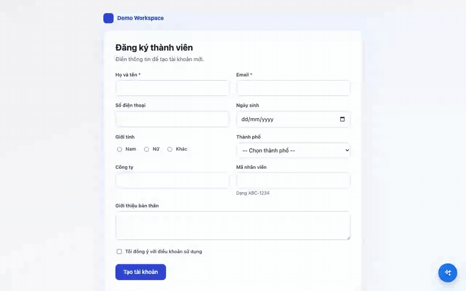

<sub>🎬 <a href="docs/demo.mp4">Xem bản MP4 nét hơn</a> · quay bằng <code>test/record-demo.mjs</code></sub>

<br /><br />

<a href="https://github.com/haonguyenstech/ai-form-filler/releases/latest"><b>⬇️ Tải bản mới nhất (.zip)</b></a>

</div>

---

## Features

### ⚡ One click, the whole form
A floating bubble scans the page, asks the AI and fills everything, then gets out of the way so you see the result. Turn on **Preview** to review and edit each value before it is applied.

### 🧩 Works with real component libraries
Plain HTML inputs **and** shadcn / Radix Selects, react-day-picker date pickers, comboboxes with async options, MUI, Ant Design, Mantine, Vuetify, Angular Material, checkboxes, radios, textareas, and forms inside modal dialogs. **26 of 26** test pages pass, see [Coverage](#coverage).

### 🧑 One consistent person per fill
| | |
|---|---|
| **Persona** | Every fill invents one person (name, email, phone, address, company, birth date), so the email matches the name and the phone/postcode match the country. |
| **Locale** | *Settings → Fake data locale*: English, Vietnamese, Japanese, French, German, Spanish, or *Auto* from the page's `<html lang>`. |
| **Instructions** | Type *"a 30-year-old engineer from Vietnam"*, save reusable ones, and mark one ⭐ default for new pages. |
| **Per-field ✨** | A Grammarly-style button on the focused field regenerates just that value. |

### ✅ Respects the page's validation
`pattern`, `min`/`max`/`step` and `minLength` go to the model. After the fill the extension asks the page which values it rejected (native constraint validation, plus the `aria-invalid` + error text form libraries show) and sends only those back with the page's own error message. A field that still fails its `pattern` gets a value built from the pattern itself.

### 🛟 Never stuck on a quota
If the AI can't answer (the free model's daily cap, a busy model, no network, a garbled reply), the form is still filled from locally generated data for the same persona, and the status says why. Only a missing or invalid key, or a wrong model id, stops the fill.

### 🧰 And the small things
Undo the last fill, a per-site on/off switch, a draggable bubble, real labels instead of "field 3", tabs for *Fill · Instructions · Settings*, light and dark mode, shortcut <kbd>⌘</kbd>/<kbd>Ctrl</kbd> <kbd>Shift</kbd> <kbd>F</kbd>.

---

## 🚀 Cài đặt cho Chrome / Edge

**[⬇️ Tải bản mới nhất (file .zip)](https://github.com/haonguyenstech/ai-form-filler/releases/latest)**, rồi làm theo 6 bước bên dưới. Mất khoảng 2 phút.

Tiện ích chạy trên **Google Chrome** và **Microsoft Edge** trên máy tính.

### Bước 1 — Tải file .zip về máy

Mở trang [Releases](https://github.com/haonguyenstech/ai-form-filler/releases/latest), ở mục **Assets** bấm vào file
`ai-form-filler-x.y.z.zip`. Trình duyệt tải về một file .zip nhỏ (khoảng 100 KB) vào thư mục **Downloads (Tải xuống)**.

> Đừng bấm *Source code (zip)* — đó là mã nguồn kèm bộ test, không phải bản cài.

<p align="center">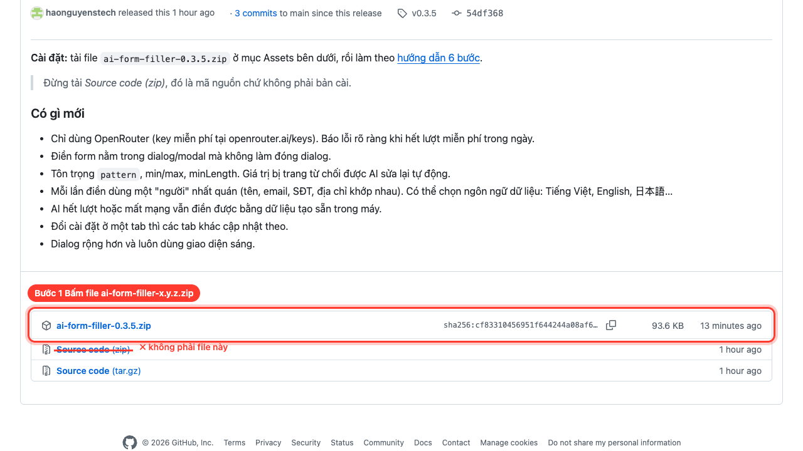</p>

### Bước 2 — Giải nén ra một thư mục và để yên ở đó

- **Trên Mac:** bấm đúp vào file .zip, máy sẽ tạo một thư mục cùng tên.
- **Trên Windows:** bấm chuột phải vào file .zip, chọn **Extract All (Giải nén tất cả)** rồi bấm **Extract**.

Nên chuyển thư mục vừa giải nén vào **Documents (Tài liệu)** để khỏi lỡ tay xoá.

> 📌 Trình duyệt chạy tiện ích trực tiếp từ thư mục này. Xoá hoặc di chuyển thư mục thì tiện ích sẽ ngừng hoạt động.

### Bước 3 — Mở trang Tiện ích của trình duyệt

Chép địa chỉ bên dưới, bấm vào thanh địa chỉ của trình duyệt, dán (**Ctrl + V**, trên Mac là **Command + V**) rồi bấm **Enter**.

| Chrome | Edge |
|---|---|
| `chrome://extensions` | `edge://extensions` |

> 📌 Trang web không được phép mở sẵn địa chỉ này cho bạn, nên phải dán vào thanh địa chỉ.

### Bước 4 — Bật Developer mode (Chế độ nhà phát triển)

- **Chrome:** ở góc **trên bên phải** của trang, bật công tắc **Developer mode**.
- **Edge:** ở **cột bên trái** của trang, gần phía dưới, bật công tắc **Developer mode**.

> 📌 Chế độ này chỉ cho phép cài tiện ích từ một thư mục trên máy, không làm thay đổi gì khác.

| Chrome — công tắc ở góc trên bên phải | Edge — công tắc ở cuối cột bên trái |
|---|---|
| 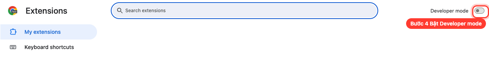 | 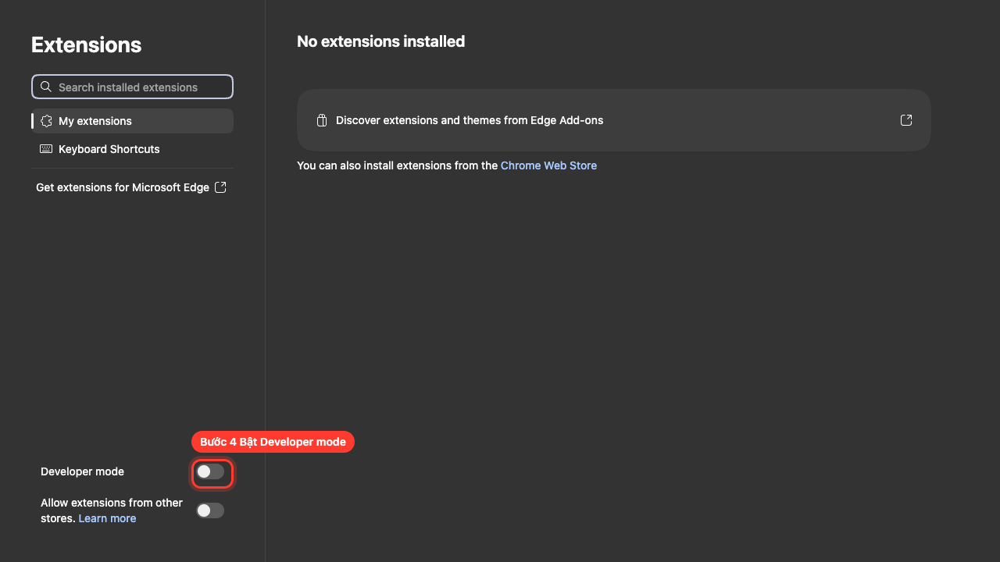 |

### Bước 5 — Bấm Load unpacked và chọn thư mục đã giải nén

Sau khi bật Developer mode, phía trên trang hiện thêm vài nút. Bấm **Load unpacked (Tải tiện ích đã giải nén)**,
chọn thư mục đã giải nén ở bước 2 rồi bấm **Select (Chọn)**.

> 📌 Chọn đúng thư mục chứa file `manifest.json`, không chọn file .zip.

| Chrome | Edge |
|---|---|
| 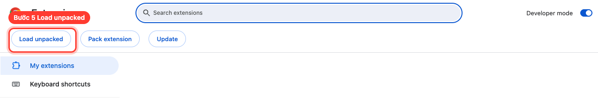 | 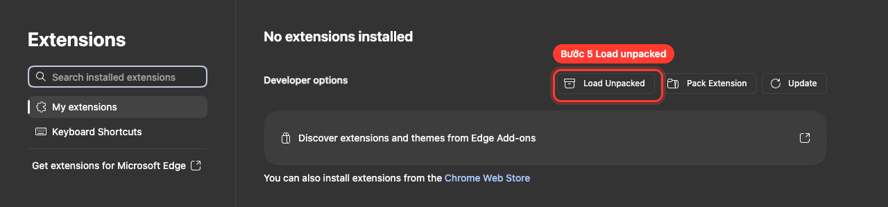 |

Cài xong, thẻ **AI Form Filler** hiện trong danh sách tiện ích, công tắc ở góc dưới thẻ đang bật. Nút ↻ trên thẻ dùng khi [cập nhật lên bản mới](#cập-nhật-lên-bản-mới).

<p align="center">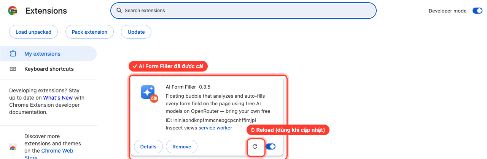</p>

### Bước 6 — Ghim tiện ích và nhập API key

1. Bấm biểu tượng **mảnh ghép** 🧩 trên thanh công cụ của trình duyệt, bấm **ghim** 📌 cạnh *AI Form Filler* để nó luôn hiện ra.
2. Lấy API key miễn phí theo [hướng dẫn lấy OpenRouter API key](#-lấy-openrouter-api-key-miễn-phí) bên dưới (khoảng 2 phút). Key bắt đầu bằng `sk-or-v1-`.
3. Mở một trang bất kỳ có form, bấm vào **bong bóng xanh** ở góc dưới bên phải (hoặc biểu tượng tiện ích), chọn tab **Settings**, dán key vào ô **OpenRouter API Key** rồi bấm **Test connection**. Hiện *Connected* là xong.

> 📌 Key miễn phí cho 50 lượt/ngày với các model `:free` (nạp 10 credits thì lên 1000 lượt/ngày). Hết lượt
> tiện ích vẫn điền được form bằng dữ liệu tạo sẵn trong máy.

<p align="center">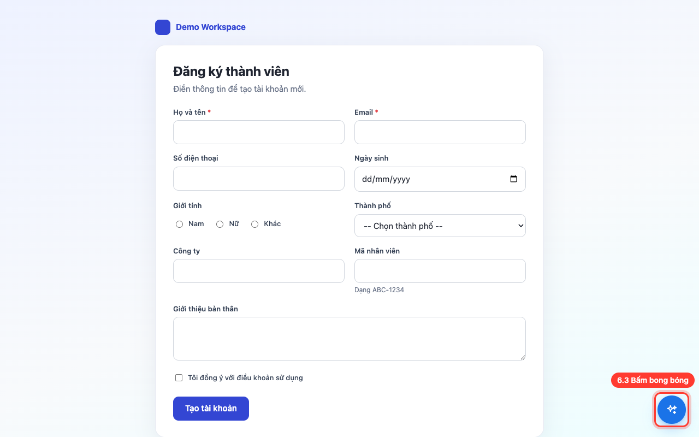 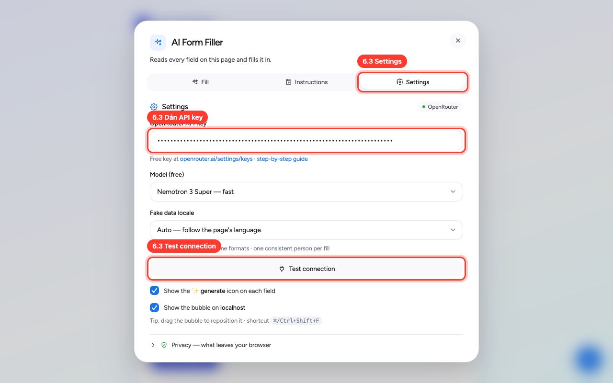</p>

<details>
<summary><b>🔑 Lấy OpenRouter API key (miễn phí), có ảnh từng bước</b></summary>


Tiện ích gọi AI qua [OpenRouter](https://openrouter.ai), một cổng kết nối tới nhiều model AI. Các model có đuôi `:free`
dùng miễn phí, **không cần nhập thẻ**, chỉ cần một API key.

**1. Tạo tài khoản OpenRouter.** Mở [openrouter.ai](https://openrouter.ai), bấm **Sign Up** ở góc trên bên phải.
Cách nhanh nhất là bấm biểu tượng **GitHub** hoặc **Google**, hoặc điền email và mật khẩu rồi bấm **Continue**.
Đã có tài khoản thì bấm **Sign in** ở cuối hộp thoại.

<p align="center">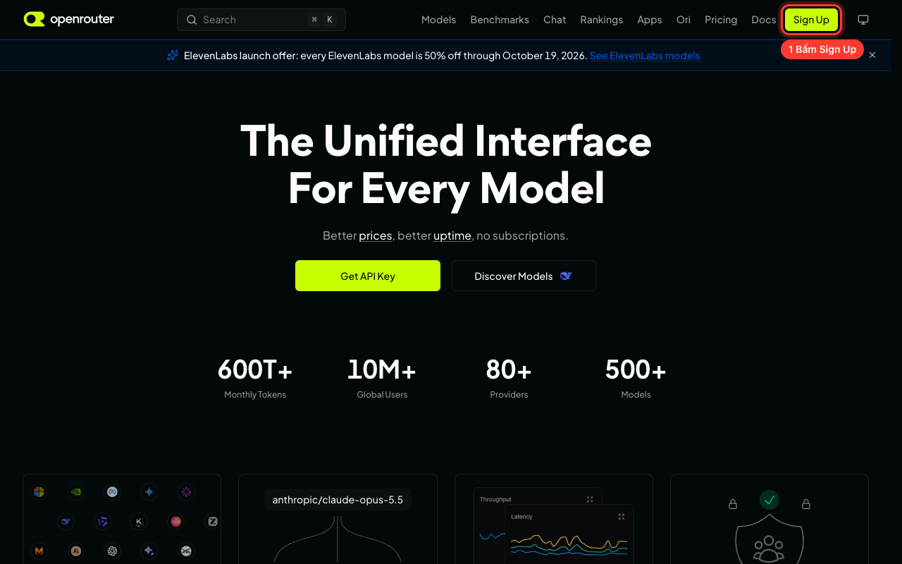 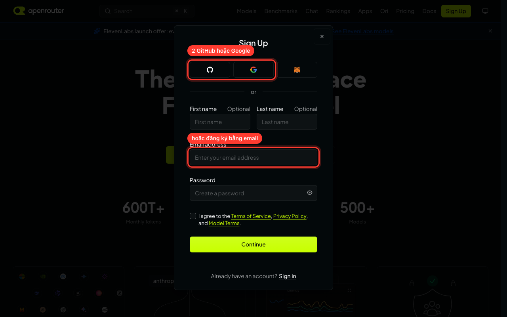</p>

**2. Mở trang API Keys.** Vào thẳng [openrouter.ai/settings/keys](https://openrouter.ai/settings/keys), hoặc chọn
**API Keys** ở cột bên trái. Bấm nút **New Key** ở góc trên bên phải.

<p align="center">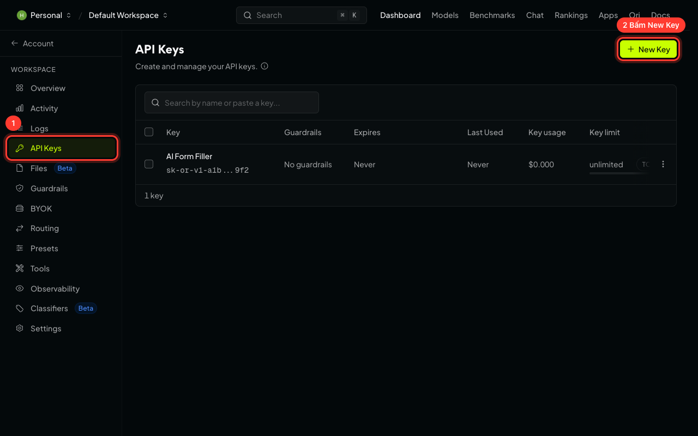</p>

**3. Điền thông tin key rồi bấm Create.**
- **Name:** đặt tên tuỳ ý, ví dụ `AI Form Filler`.
- **Expiration:** chọn **No expiration** để key không tự hết hạn. Muốn an toàn hơn thì chọn 90 days hoặc 1 year, nhưng nhớ tạo key mới khi key cũ hết hạn.
- **Credit limit:** chọn **No limit**. Model `:free` không trừ tiền nên không cần giới hạn. Nếu sau này nạp credits thì nên chọn **Custom amount** và đặt mức nhỏ, phòng khi lộ key.

Khung cảnh báo màu vàng *"This key never expires and has no credit limit…"* là bình thường, cứ bấm **Create**.

<p align="center">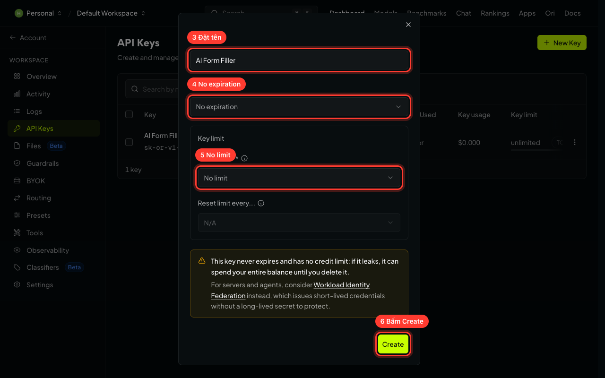</p>

**4. Nhập mã xác minh email.** OpenRouter gửi một mã 6 số về email của tài khoản. Mở email, nhập mã rồi bấm
**Continue**. Không thấy email thì kiểm tra thư mục Spam, hoặc chờ hết đếm ngược rồi bấm **Resend**.

<p align="center">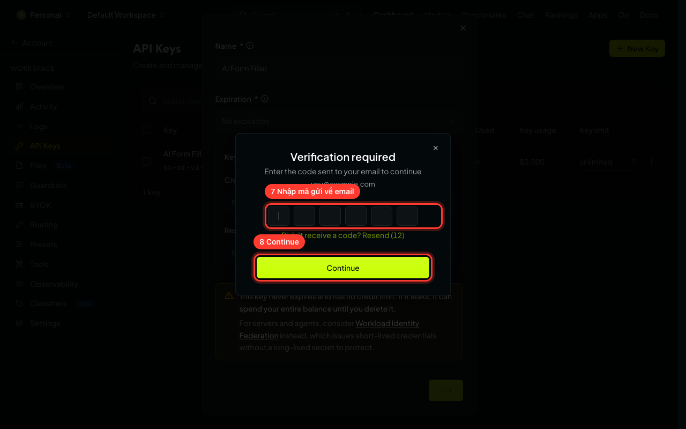</p>

**5. Chép key ngay.** Key dạng `sk-or-v1-…` chỉ hiện **một lần duy nhất**. Bấm nút copy và dán vào tiện ích ngay
(bước 6 ở trên: bong bóng → **Settings** → **OpenRouter API Key** → **Test connection**).

> 📌 Lỡ đóng hộp thoại mà chưa chép thì không xem lại được. Xoá key đó (nút ⋮ cuối dòng) và tạo key mới.

**6. Bật model miễn phí trong Privacy (nếu Test connection báo lỗi privacy).** Mở
[openrouter.ai/settings/privacy](https://openrouter.ai/settings/privacy), kéo xuống mục **Data Training** và **bật**
**Allow free endpoints that train on request data**. Đa số nhà cung cấp model miễn phí có quyền lưu hoặc dùng prompt
để huấn luyện. Khi tuỳ chọn này tắt, OpenRouter không cho gọi họ và tiện ích báo *"Your OpenRouter privacy settings
block free models"*. Cũng kiểm tra mục **Zero Data Retention** ở đầu trang: dòng *All other models* phải đang **tắt**.

<p align="center">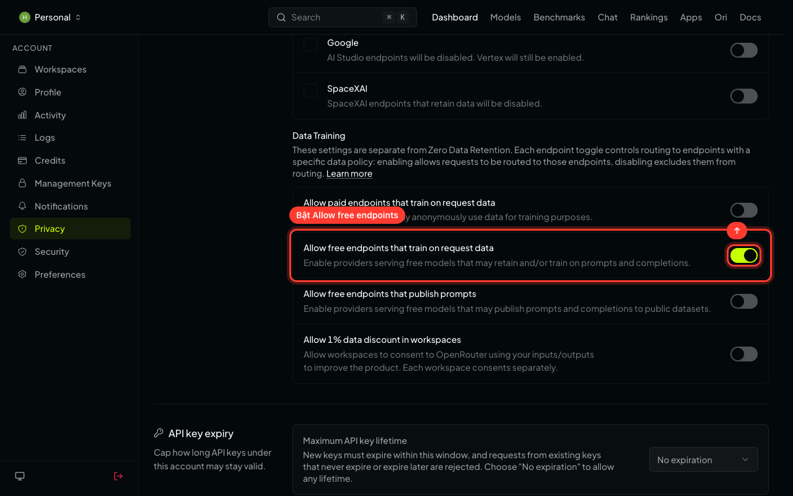</p>

> 📌 Tiện ích chỉ gửi mô tả của từng field (label, kiểu, các lựa chọn) và một "người" giả, không gửi dữ liệu bạn đã
> nhập. Chi tiết ở mục [Privacy](#-privacy).

**Giới hạn của key miễn phí**

| Tài khoản | Lượt gọi model `:free` |
|---|---|
| Chưa nạp tiền | **50 lượt/ngày**, reset lúc 00:00 UTC (7:00 sáng giờ Việt Nam) |
| Đã nạp từ 10 credits (~10 USD) trở lên | **1000 lượt/ngày** (model `:free` vẫn không trừ credits) |

Mỗi lần bấm **Analyze & Fill** tốn 1 lượt, thêm 1 lượt nếu trang từ chối vài giá trị và tiện ích gửi lại để sửa.
Hết lượt thì tiện ích vẫn điền form bằng dữ liệu tạo trong máy và ghi rõ giờ reset.

**Giữ key an toàn:** không dán key lên chat, Git hay tài liệu chung. Key nằm trong bộ nhớ của tiện ích trên máy bạn
(`chrome.storage`, có đồng bộ nếu bạn bật Chrome Sync). Nghi bị lộ thì vào [openrouter.ai/settings/keys](https://openrouter.ai/settings/keys) xoá key và tạo key mới.

</details>

<details>
<summary><b>🔄 Cập nhật lên bản mới</b></summary>


1. **Tải bản mới và giải nén** — tải file .zip mới ở trang [Releases](https://github.com/haonguyenstech/ai-form-filler/releases/latest) và giải nén.
2. **Chép đè vào thư mục cũ** — chép toàn bộ nội dung thư mục mới đè lên thư mục đang cài (thư mục bạn đã chọn khi Load unpacked), đồng ý thay thế các file trùng tên.
3. **Tải lại tiện ích** — mở lại `chrome://extensions` (hoặc `edge://extensions`), tìm *AI Form Filler* và bấm biểu tượng **mũi tên vòng tròn (Reload)** trên thẻ của nó. Các tab đang mở cần tải lại trang (F5) để nhận bản mới.

> ⚠️ Đừng bấm **Remove (Xoá)** tiện ích rồi cài lại: xoá tiện ích sẽ xoá luôn API key, instruction đã lưu và cài đặt của bạn.

</details>

---

## 🧭 Cách dùng

### 1. Mở bong bóng

Trên trang có form, bấm **bong bóng xanh** ở góc dưới bên phải (hoặc biểu tượng tiện ích trên thanh công cụ, hoặc <kbd>⌘</kbd>/<kbd>Ctrl</kbd> <kbd>Shift</kbd> <kbd>F</kbd>). Bong bóng kéo đi chỗ khác được nếu che mất nội dung.

<p align="center">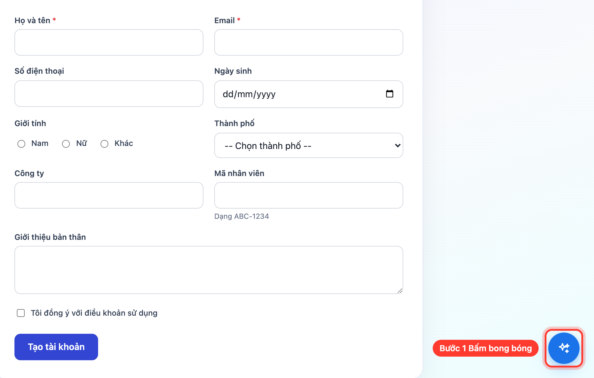</p>

### 2. Mô tả người cần điền rồi bấm Analyze & Fill

- **Bước 2:** gõ vài chữ mô tả "người" sẽ điền form, ví dụ *kỹ sư phần mềm 28 tuổi ở Đà Nẵng*. Bỏ trống cũng được, tiện ích tự nghĩ ra một người hợp lý.
- **Bước 3:** bật **Preview before filling** nếu muốn xem lại giá trị trước khi điền.
- **Bước 4:** bấm **Analyze &amp; Fill Form**. **Fill which fields** cho phép chỉ điền ô bắt buộc (có dấu *) hoặc chỉ ô không bắt buộc.

<p align="center">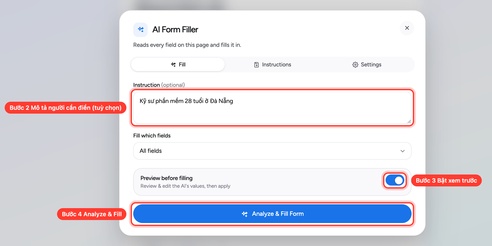</p>

### 3. Xem lại rồi Apply

Khi bật Preview, tiện ích hiện danh sách giá trị AI đề xuất.

- **Bước 5:** sửa thẳng vào ô nào chưa ưng, hoặc bấm ↻ cạnh ô để AI tạo lại riêng giá trị đó.
- **Bước 6:** bấm **Apply**. Form được điền, hộp thoại tự đóng để bạn xem kết quả.

<p align="center">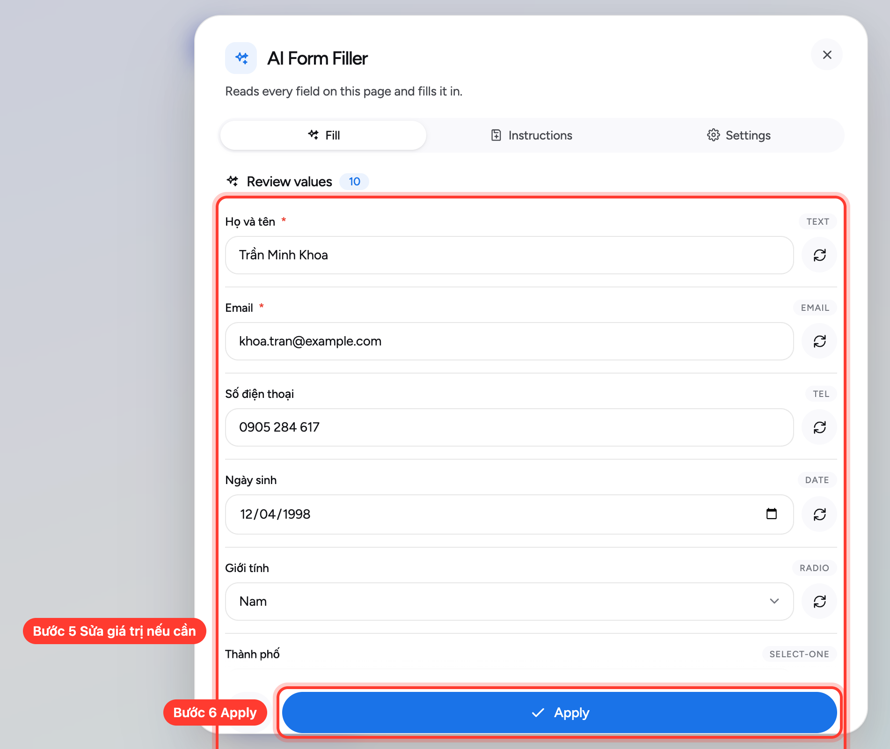</p>

> 📌 Trang báo lỗi giá trị nào (sai định dạng, quá ngắn…) thì tiện ích tự gửi lại đúng những ô đó kèm lời báo lỗi của trang, và sửa cho tới khi hợp lệ.

### 4. Tạo lại một ô bằng nút ✨

Bấm vào một ô bất kỳ, nút **✨** hiện ở mép phải ô. Bấm nó để AI viết lại riêng ô đó, các ô khác giữ nguyên.

<p align="center">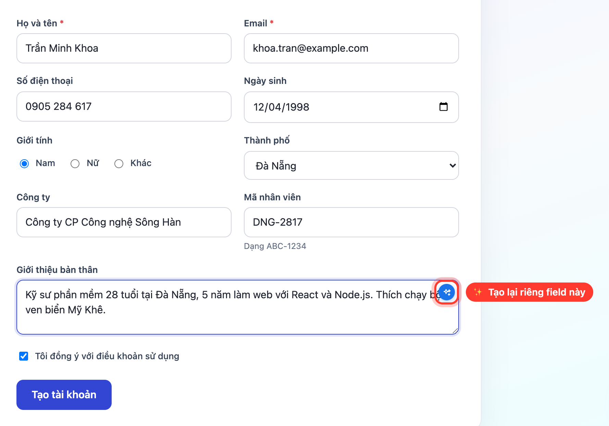</p>

> 📌 Không thích nút này thì bỏ chọn **Settings → Show the ✨ generate icon on each field**.

### 5. Hoàn tác

Điền nhầm form? Mở lại bong bóng, bấm **Undo last fill**. Mọi ô quay về giá trị trước khi điền.

<p align="center">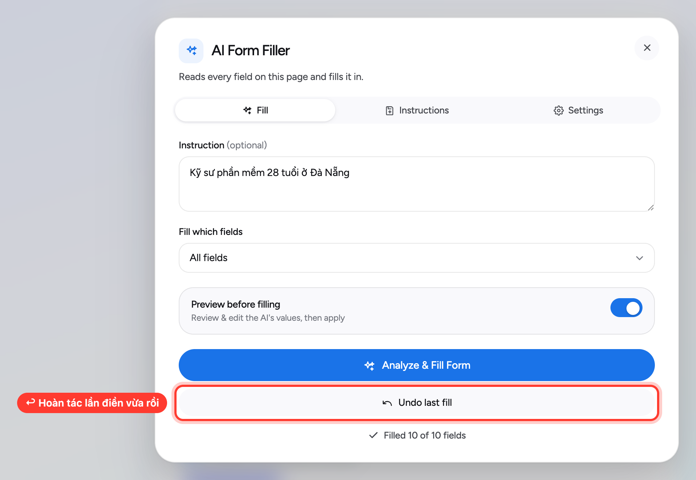</p>

### 6. Lưu instruction hay dùng

Tab **Instructions**:

1. Viết instruction vào ô trên cùng rồi bấm **Save instruction**.
2. Bấm ★ để đặt làm **mặc định**: trang mới mở ra sẽ có sẵn instruction này.
3. Bấm vào một dòng để dùng ngay, tiện ích chuyển về tab Fill.

<p align="center">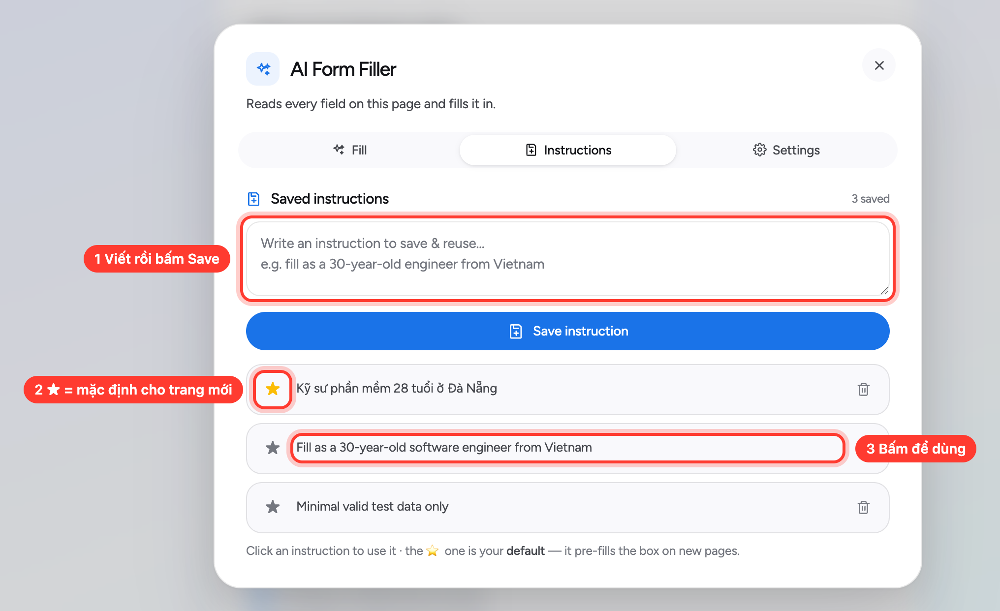</p>

> 📌 Instruction đồng bộ qua Chrome Sync nếu bạn bật Sync, nên dùng được trên máy khác.

---

## Model

The extension calls **OpenRouter** (`openrouter.ai/api/v1/chat/completions`) straight from the background service worker with your own API key. Paste a free key into **Settings** ([how to get one](#-cài-đặt-cho-chrome--edge)). The **Model** dropdown offers OpenRouter's free models; a fresh install starts on the first one:

| Model | Notes |
|---|---|
| `nvidia/nemotron-3-super-120b-a12b:free` | **default** — ~2–3s for a short reply |
| `cohere/north-mini-code:free` | fast |
| `poolside/laguna-s-2.1:free` | slower (~9s) |
| `nvidia/nemotron-3.5-lightning:free` | ~11–14s |
| `nvidia/nemotron-3-ultra-550b-a55b:free` | slowest (~30s through a full fill) |

**Custom…** takes any OpenRouter model id, paid ones included. OpenRouter's free catalogue
changes often; if a model errors, pick another or check `https://openrouter.ai/api/v1/models`.
Use **Test connection** in Settings to check the key and model; the button shows a spinner while
in flight and settles to *Connected* / *Failed*.

> Earlier versions defaulted to a keyless OpenCode Zen provider. OpenCode has since restricted
> its free tier to its own app, so that provider was removed in 0.3.5.

---

## How it works

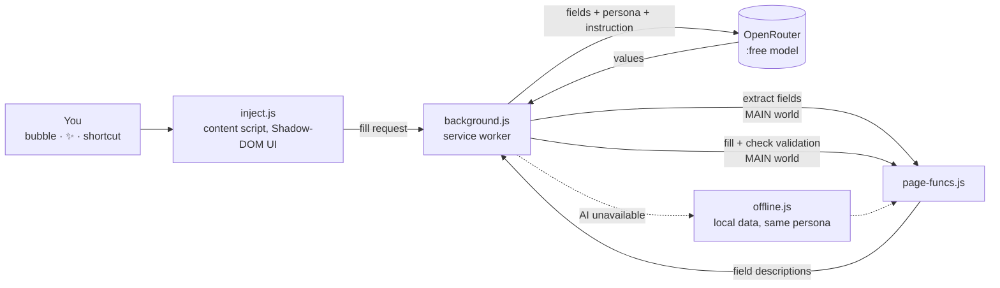

- `inject.js`: content script (top frame, `<all_urls>`). Renders the bubble and a Shadow-DOM dialog so the page's CSS can't leak in or out. Holds all UI, settings, the per-field icon and the review flow.
- `background.js`: service worker. Calls the AI (avoids page CORS) and orchestrates **extract → AI → fill → celebrate**. The extract/fill steps run in the page's **MAIN world** via `chrome.scripting.executeScript`, because synthetic clicks from the isolated content-script world don't reliably drive Radix widgets; the same clicks from the MAIN world do.
- `page-funcs.js`: self-contained functions injected into the page's MAIN world to scan fields, fill values (React-safe: native value setter + `input`/`change`/`blur` events) and run the success animation.
- `offline.js`: the local fallback that fills the same persona when the AI can't answer.

### Coverage

`test/survey.mjs` loads the real extension, drives its UI with real pointer input, and answers
the AI call with values built from the request's own field list — no model in the loop, so the
numbers measure this code rather than the AI. Current run: **26 of 26 pages pass.**

| Group | Pages | Result |
|---|---|---|
| Forms inside a page dialog | native `<dialog>`, Bootstrap modal, Radix + Select, MUI Dialog, Headless UI, Ant Design Modal (local, `test/dialogs/`); mui.com form dialog, shadcn dialog, Bootstrap docs modal, Mantine modal (live) | 10/10 — every field filled, dialog stays open, nothing behind it touched |
| Plain pages | selenium web-form, demoqa, httpbin, formy, testautomationpractice, expandtesting, Bootstrap, MUI text field / select, Ant Design form, Element Plus, Vuetify, Mantine, Angular Material, Chakra, shadcn react-hook-form | 16/16 |

```bash
cd test && python3 -m http.server 5199 &   # the local dialog pages
node survey.mjs            # all 26     · node survey.mjs dialog   · node survey.mjs local
ORKEY=sk-or-... node survey.mjs local     # same pages against the real model
```

**Forms in dialogs.** With a page modal open, only its fields are scanned. The extension never
sends Escape to the document or clicks a modal's backdrop — popups it opened are closed through
their own backdrop or a press on a neutral spot inside the dialog, because React bubbles Escape
through portals and MUI / antd dialogs closed on it. Its own UI stops every interaction event at
its host, so a click on the bubble is not an "outside click" to Radix or MUI, and while a native
`<dialog>` is open modally the UI moves inside it (everything else is inert, top-layer popovers
included).

**Not filled on purpose:** controls in `header` / `nav` / `role=banner|navigation|search`
outside a form — a docs-site version picker is a combobox, and filling it navigated
ant.design to 5x.ant.design.

Known limits: MUI Select's one demo whose menu renders outside the document flow (24 of 25), and
MUI X date fields, which are contenteditable spans rather than inputs.

`<datalist>` suggestions are not harvested — such an input is treated as free text.

Calendar widgets are reached either through their month/year `<select>`s or by stepping months,
budgeted to 60 years, so ordinary birth dates work. Dates further back than that will not resolve.

---

## Privacy

The extension makes **one network request per fill** (a second one only when the page rejects values and they go back for correction), to OpenRouter. If that request fails, the form is filled from locally generated data with no further requests. There is
no analytics, no telemetry and no server of this project's own — `fetch` appears twice in the whole
codebase, both times pointing at the OpenRouter endpoint.

**What is sent** — a *description* of each field, never its contents:

| Sent | Not sent |
|---|---|
| `label`, `name`, `placeholder` | values already in the fields (`currentValue` is read to power Undo but is stripped before the request) |
| `type`, `required`, `maxLength`, `minLength`, `pattern`, `min`/`max`/`step` | the page's text, its URL, cookies, anything from other tabs |
| a dropdown's list of options | password and file inputs — not read, not filled, not extracted at all |
| the instruction you type | — |
| the invented persona and the locale | — |
| for a value the page rejected: that value (which the model itself produced) and the page's error message for that field | — |

Settings and saved instructions live in `chrome.storage` on your machine; filled values are never
recorded anywhere.

> **Two caveats worth stating plainly.**
>
> 1. A `<select>`'s option labels come from the page, so if a dropdown enumerates real records
>    (customers, patients, accounts) those labels are part of the request. That is unavoidable —
>    the model has to pick from the real choices.
> 2. Providers behind OpenRouter's `:free` models **may log prompts and use them to improve their
>    models**, and free models can be withdrawn at any time.
>
> Together those mean the free models should be treated as **public**: fine for scratch and
> staging forms, not for pages listing data you cannot hand to a third party. For anything
> confidential, pick a paid model and read that provider's terms.

The same summary is available in-product under **Settings → Privacy**.

---

## Development

### Run from source

```bash
git clone https://github.com/haonguyenstech/ai-form-filler.git
```

Then follow install steps 3–5 and pick the cloned folder in **Load unpacked**.

### Tests

A Playwright suite runs against a real Radix + react-day-picker test page:

```bash
cd test
npm install
npm test
```

### Docs media

Everything under `docs/` is generated from the real extension on `test/forms/demo.html`, with a canned AI answer so it costs no quota and comes out the same every run:

```bash
cd test && python3 -m http.server 5199 &
node record-demo.mjs    # docs/demo.mp4 + docs/demo.gif
node usage-shots.mjs    # docs/usage/*.png, the annotated "Cách dùng" screenshots
```

### Project layout

```
manifest.json      MV3 manifest
inject.js          content script: bubble, Shadow-DOM dialog, settings, ✨ icon, review
background.js      service worker: OpenRouter call, extract → AI → fill → validate
page-funcs.js      functions run in the page's MAIN world (scan, fill, celebrate)
offline.js         local persona + data when the AI is unavailable
fonts/             Figtree subsets (woff2)
icons/             generated by test/make-icons.mjs
store/             Chrome Web Store listing + privacy policy
test/              Playwright suite, survey, demo + screenshot recorders
```

<details>
<summary><b>🎨 Design</b></summary>

The UI follows the [antigravity.google](https://antigravity.google/) design language: near-black
ink (`#121317`) for type, a cool blue-grey tint for every secondary surface, pill geometry and
hairline borders. Google blue (`#1A73E8`) carries the primary action — bubble, fill button,
per-field ✨ icon — so the dialog reads light rather than resting on a black slab; the other
brand colours appear only in the success confetti. Dark mode inverts the same token set and
flips the accent to `#8AB4F8`.

The type is **Google Sans Flex** where the system has it, falling back to **Figtree** (SIL OFL),
which ships in `fonts/` as two ~15 KB woff2 subsets — no network request, no page-CSP problem.
`@font-face` can't live inside a shadow root, so the family is registered on the document under
the private name `AIFF Sans` and referenced from the shadow CSS.

</details>

<details>
<summary><b>🖼 Icon</b></summary>

`icons/*.png` are generated, not hand-drawn — edit the SVG in `test/make-icons.mjs` and run:

```bash
cd test && npm run icons
```

The mark is a four-point sparkle on the same accent blue the UI uses. The 16/32 px files
are drawn from a **different** source shape than 48/128 (optical sizing): pointy arms and
the companion sparkle read as craft at 128 px and as dirt at 16 px, so the toolbar sizes
get a single, blunter, larger star.

</details>

### Publishing

`./build.sh` produces `dist/ai-form-filler-<version>.zip` containing only what the manifest
references — the test suite and icon generator are left out. `store/LISTING.md` holds the
description, permission justifications and data-usage answers the Chrome Web Store asks for, and
`store/privacy-policy.html` is the policy page (a public URL for it is mandatory).

Bump `version` in `manifest.json` before every upload; the store refuses a version it has seen.

---

## Credits

- [Figtree](https://github.com/erikdkennedy/figtree) by Erik Kennedy, the UI font (SIL OFL)
- [OpenRouter](https://openrouter.ai), the model gateway
- Design language after [antigravity.google](https://antigravity.google/)

<div align="center"><sub>MIT License</sub></div>
